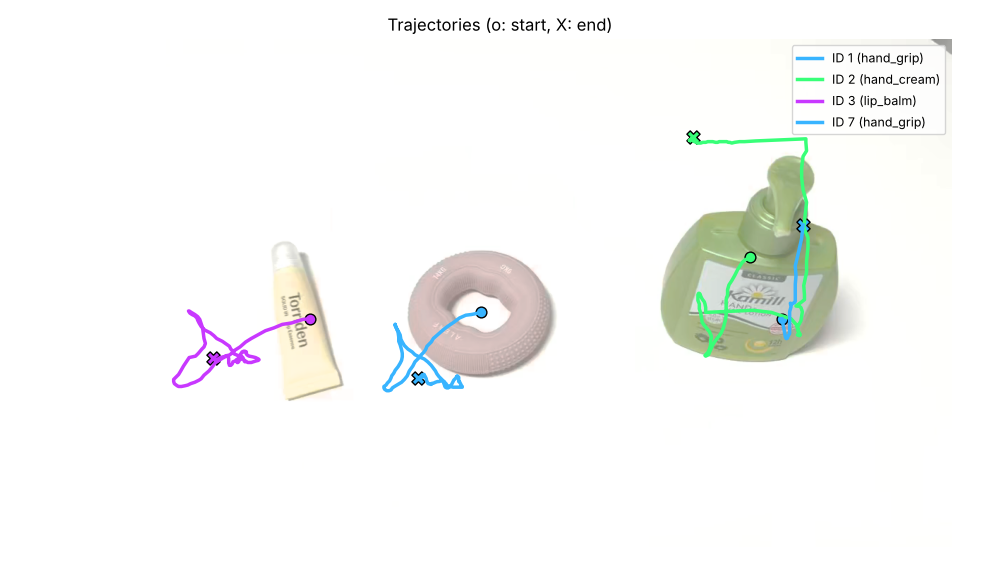
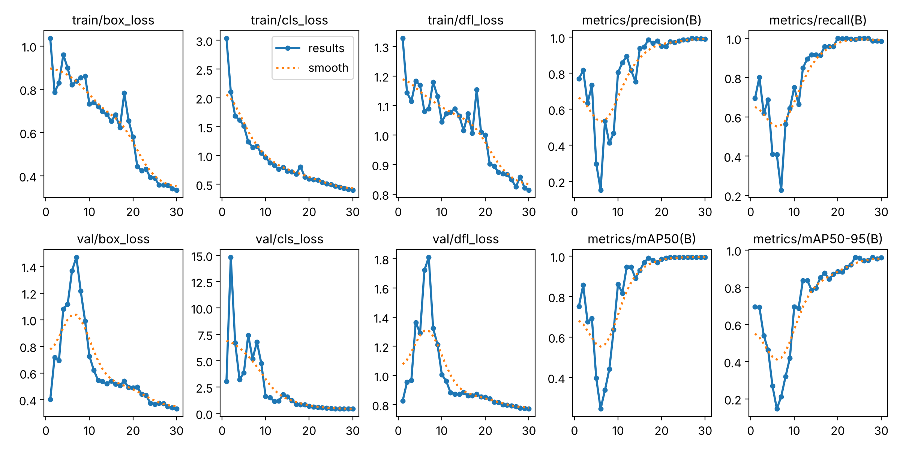
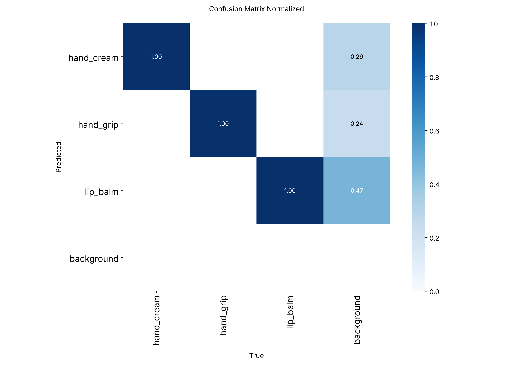

# YOLOv8 3-Class Fine-tuning & Object Tracking

COCO로 사전학습된 **yolov8n** 모델을 직접 수집·라벨링한 3개 부류(**hand_cream, hand_grip, lip_balm**) 데이터셋으로 fine-tuning하고,
5초 영상에서 객체 감지와 추적(ByteTrack)을 수행한 결과입니다.

## 결과 영상
https://github.com/ieonovun/yolov8-3class-tracking/raw/main/tracking_result.mp4



## 데이터셋
| split   |   images |   hand_cream |   hand_grip |   lip_balm |
|:--------|---------:|-------------:|------------:|-----------:|
| train   |       94 |           37 |          29 |         28 |
| valid   |       27 |            9 |          10 |          8 |
| test    |       13 |            5 |           3 |          5 |
| total   |      134 |           51 |          42 |         41 |

## 학습 설정
| 항목 | 값 |
|---|---|
| 기반 모델 | yolov8n.pt (COCO pretrained) |
| epochs | 30 (patience 20) |
| image size | 480 |
| batch | 16 |
| 실제 학습 epoch | 30 |

## 성능 (test set, mAP50 = 0.995, mAP50-95 = 0.918)
| split   | class      |     P |     R |   mAP50 |   mAP50-95 |
|:--------|:-----------|------:|------:|--------:|-----------:|
| val     | all        | 0.978 | 0.995 |   0.995 |      0.962 |
| val     | hand_cream | 0.965 | 1     |   0.995 |      0.979 |
| val     | hand_grip  | 0.97  | 1     |   0.995 |      0.995 |
| val     | lip_balm   | 1     | 0.986 |   0.995 |      0.912 |
| test    | all        | 0.941 | 1     |   0.995 |      0.918 |
| test    | hand_cream | 0.922 | 1     |   0.995 |      0.995 |
| test    | hand_grip  | 0.907 | 1     |   0.995 |      0.995 |
| test    | lip_balm   | 0.996 | 1     |   0.995 |      0.763 |




## 사용 방법
```python
from ultralytics import YOLO
model = YOLO('best.pt')
model.predict('image.jpg', save=True)                                   # 감지
model.track('video.mp4', tracker='bytetrack.yaml', save=True)           # 추적
```

## 파일 구성
- `best.pt` — 학습된 모델
- `tracking_result.mp4` — 5초 감지·추적 결과 영상
- `trajectories.csv` — 프레임별 객체 ID, 부류, 중심좌표 (궤적 데이터)
- `*.png`, `*.csv` — 학습 곡선, 혼동행렬, PR 곡선, 성능표
- `data.yaml` — 데이터셋 설정
